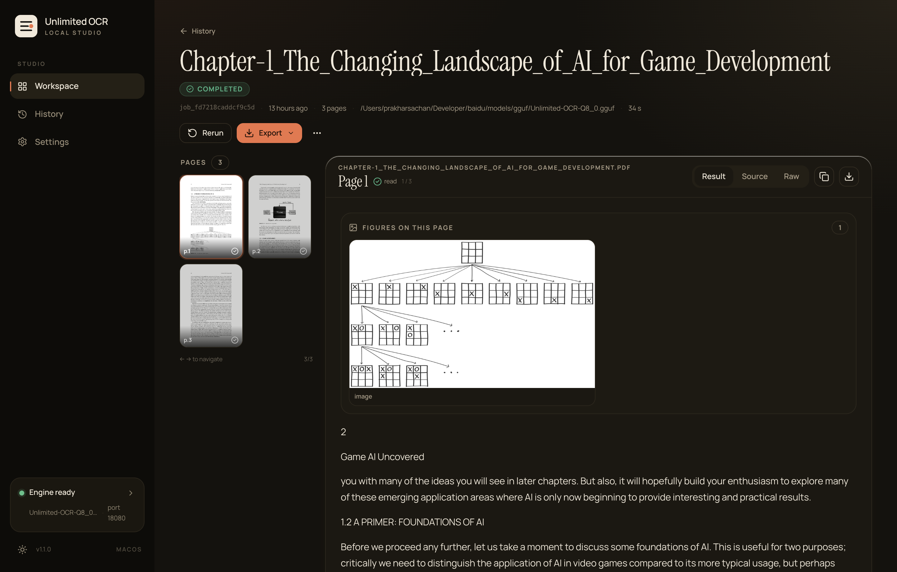
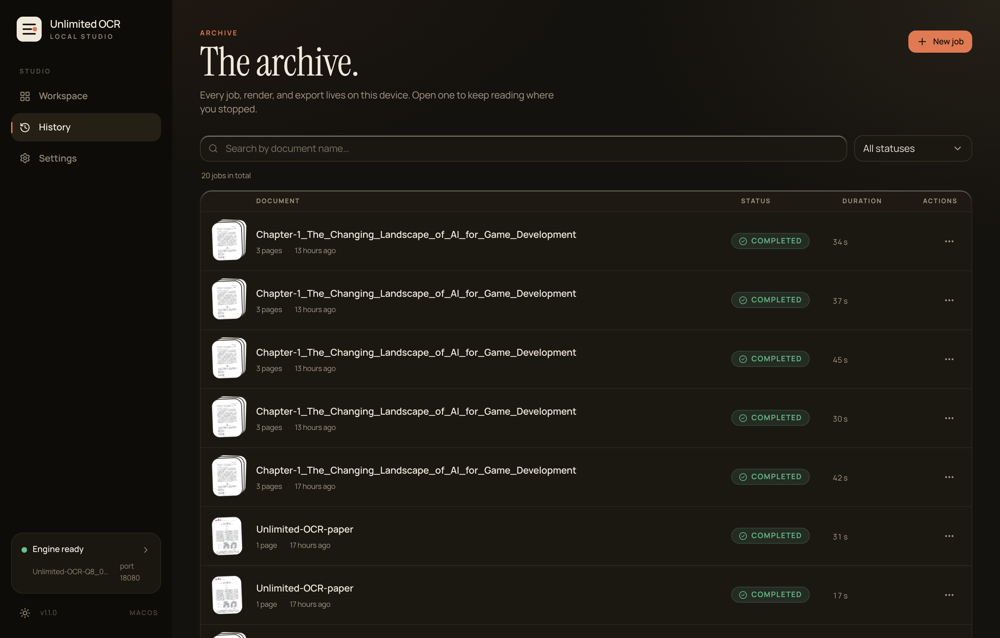
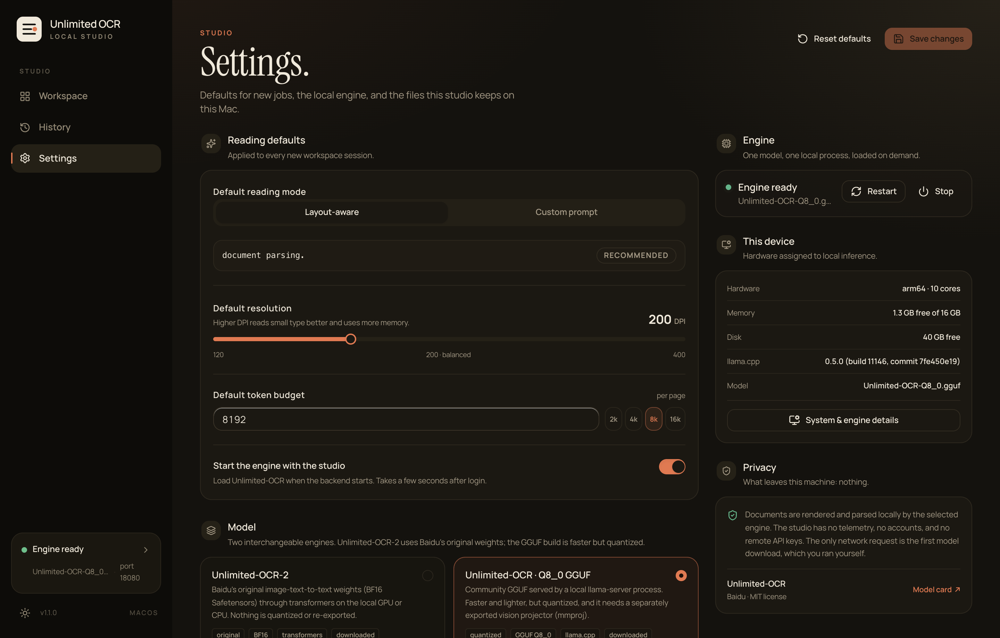

# Unlimited OCR Studio

A private, local-first OCR workbench for **Baidu Unlimited-OCR**, running on
macOS, Linux, and Windows. Documents never leave the machine: the FastAPI
backend renders pages with PyMuPDF, runs them through a local inference engine,
and streams structured Markdown to a React studio UI.



## Screenshots

| Workspace & Document Queue | Live Job Streaming & KaTeX Preview |
| :---: | :---: |
|  |  |
| **History & Export Search** | **Engine & System Settings** |
|  |  |

- **Model weights** live in [`models/`](models) and are loaded from this folder —
  no Docker, no Hugging Face cache, no cloud round-trip.
- **Backend** — FastAPI + SQLite, a single-worker job queue, and SSE streaming
  (`backend/`).
- **Frontend** — React + TypeScript + Vite + Tailwind v4, shadcn-style
  components, TanStack Query (`frontend/`).
- **Data** — uploads, rendered pages, thumbnails, SQLite archive, and logs under
  [`data/`](data), private to this machine.

## Platform support

| Platform | GGUF + llama.cpp | Unlimited-OCR-2 + transformers |
| --- | --- | --- |
| macOS 13+ (Apple Silicon) | Metal, CPU | Metal (MPS), CPU |
| Linux x86_64 / arm64 | CUDA, Vulkan, CPU | CUDA, CPU |
| Windows 10/11 x86_64 | CUDA, Vulkan, CPU | CUDA, CPU |

The launcher, path handling, process management, and file URLs are portable:
Windows paths are stored with forward slashes in SQLite and URLs, so the same
database and uploads can be read on every platform. The engine label shown in
the UI is reported by the backend (`llama.cpp · Metal`, `llama.cpp · CUDA`,
`Transformers · CUDA`, …), never hard-coded.

## Requirements

- Python **3.11+** (3.12 recommended).
- Node **20+** with [pnpm](https://pnpm.io) 9+ (npm also works).
- [llama.cpp](https://github.com/ggml-org/llama.cpp) with `llama-server` on
  `PATH` for the GGUF engine:
  - macOS: `brew install llama.cpp`
  - Windows: download a release with `llama-server.exe` and add it to `PATH`
    (or set `OCR_LLAMA_SERVER_BIN` to its full path).
  - Linux: install from your distro or a release build and put `llama-server`
    on `PATH`.
- About 4 GB of disk for the Q8_0 model + vision projector. The original
  Unlimited-OCR-2 Safetensors checkpoint is ~6.7 GB and needs PyTorch.

## Quick start

All platforms use the same Python launcher. It creates the virtualenv, installs
dependencies on first run, starts the backend, and starts the Vite dev server.

```bash
# macOS / Linux
python3 scripts/start.py             # dev:  http://127.0.0.1:5173
python3 scripts/start.py --prod      # prod: http://127.0.0.1:8000
python3 scripts/start.py --restart   # stop first; apply backend code changes
python3 scripts/stop.py

# Windows (Command Prompt / PowerShell)
py -3 scripts\start.py
py -3 scripts\start.py --prod
py -3 scripts\stop.py
```

Convenience wrappers are provided: `scripts/start.sh`, `scripts/start.cmd`,
`scripts/stop.sh`, `scripts/stop.cmd`, `scripts/test.sh`, and
`scripts/test.cmd`. `MODE=prod bash scripts/start.sh` remains supported.

## Models

```bash
# GGUF Q8_0 (default, llama.cpp) — about 3.7 GB
python scripts/download_models.py

# A smaller quant
python scripts/download_models.py --quant Q4_K_M

# Original Unlimited-OCR-2 Safetensors (transformers) — about 6.7 GB
python scripts/download_models.py --model uocr2
```

The downloader uses `huggingface_hub` and installs it if missing. The backend
never reads a global model cache at runtime; it loads `models/gguf/*.gguf`,
`models/uocr2/`, or paths configured through `OCR_MODEL_PATH` /
`OCR_MMPROJ_PATH` / `OCR_UOCR2_DIR`.

The original Safetensors engine also needs PyTorch. Install it into the backend
virtualenv with:

```bash
python scripts/install_inference.py          # CUDA/ROCm wheels when available
python scripts/install_inference.py --cpu    # CPU-only Linux/Windows
```

The GGUF + llama.cpp path needs none of that.

## What the studio does

**Workspace** — drop up to 20 files (PDF, PNG, JPEG, WebP, TIFF, BMP, GIF, HEIC,
AVIF), browse per-page thumbnails, tune the reading options, then queue a job.
Drafts autosave in `localStorage`, so a reload brings the queue back when the
uploads are still on disk. Paste an image with `⌘V` (macOS) or `Ctrl+V`
(Windows/Linux). Options: layout or custom prompt, 120–400 DPI, 512–32768
completion tokens per page, one-request batch mode (2–4 pages), repeated-margin
stripping, automatic retry of truncated pages (double the budget), temperature
and seed.

**Job view** — live SSE streaming with reconnect backoff, per-page filmstrip with
keyboard navigation (`←`/`→`), rendered Markdown with KaTeX, layout-box overlay
and a block inspector, raw `<|det|>` output, copy, export (Markdown / text /
JSON, current page or whole job), rerun, cancel, and delete with confirmations.

**History** — search and filter across every job, with per-job rerun, export and
delete.

**Settings** — default reading options, engine choice (GGUF vs original
Safetensors), accelerator (Auto / CUDA / Metal / CPU), engine
start/stop/restart, local storage paths, system details (platform, CPU, memory,
disk, llama.cpp build, model card), and a privacy panel. There is no telemetry,
no account, and no remote API key anywhere in the app.

## Architecture

```
backend/
  app/
    config.py             Settings (env prefix OCR_, .env supported)
    db.py                 SQLite: uploads, jobs, job_pages, settings
    schemas.py            Pydantic request/response + JobOptions
    errors.py             AppError codes with user-facing hints
    main.py               create_app() factory, lifespan, static serving
    api.py                REST + SSE + exports
    engine/llama_cpp.py   llama-server lifecycle, streaming chat completions
    engine/transformers_engine.py  original Safetensors model on CUDA/MPS/CPU
    engine/fake.py        deterministic engine for offline tests/E2E
    services/jobs.py      single-worker job runner (per-page / batch)
    services/ocr_text.py  <|det|> and plain block parsing, repetition guard
    services/files.py     page rendering, thumbnails, upload storage
  tests/                  pytest + unittest suites (temp data dir, no model)
frontend/
  src/components/         workspace, job, history, settings + ui primitives
  src/hooks/              useJob + SSE reconnect, health, theme
  src/lib/                typed API client, XHR uploads, router, platform helpers
  src/**/*.test.*         Vitest unit/component tests
  e2e/                    Playwright end-to-end suite
scripts/
  start.py / stop.py      cross-platform process launcher
  download_models.py      cross-platform weights downloader
  install_inference.py    optional torch/transformers installer
  test_all.py             backend + frontend + optional E2E runner
```

The frontend uses **hash routing** (`#/workspace`, `#/history`, `#/settings`,
`#/jobs/<id>`), so the production FastAPI static mount works without an SPA
fallback.

### How OCR works

1. `PyMuPDF` renders the chosen page at the requested DPI and caches a thumbnail.
2. The backend sends the image (base64 `image_url`) plus the prompt
   (`document parsing.` for layout mode) to the selected engine.
   - **GGUF**: `llama-server` on `127.0.0.1:18080` with `--jinja --temp 0`.
   - **Transformers**: the original Safetensors model through PyTorch on the
     chosen device.
3. Output arrives as `<PAGE>`-separated blocks: `label [x1,y1,x2,y2]text`.
   `ocr_text.py` parses both the `<|det|>` tagged form and the plain form left
   after special tokens are stripped, detects repetition loops, and can strip
   running margins across 3+ pages. Geometry-only `image`/`figure` blocks are
   kept; `figures.py` crops them from the page render for the UI and exports.
4. Page results are written to SQLite and broadcast over SSE; the UI renders them.

### Engine parameters

| Setting | Value |
| --- | --- |
| Port | 18080 (falls back to 18081–18099 if taken) |
| Context | 32768 |
| GPU layers | 99 (Metal/CUDA/Vulkan where available) |
| Flash attention | off (required for this decoder) |
| Parallel slots | 1 (one engine process, one job at a time) |
| Warmup | off |

Expected behaviour on an M4 (10 cores): ~2.8 s vision encoding per page, then
roughly 90–130 tokens/s of decoding — about 6–11 s for a typical text page end
to end. CUDA and CPU timings vary with the hardware.

## API summary

| Method | Path | Notes |
| --- | --- | --- |
| GET | `/api/health` | app + engine status, version, log tail |
| GET | `/api/system/status` | same payload as health |
| GET | `/api/system/models` | active model + projector presence |
| GET | `/api/system/diagnostics` | health + models + engine facts in one payload |
| GET | `/api/system/engines` | facts about both engines (Settings picker) |
| GET | `/api/system/logs` | last engine/backend log lines (plain text) |
| POST | `/api/system/engine/start\|stop\|restart` | engine lifecycle |
| POST | `/api/system/clear-history` | delete all jobs |
| GET/PUT | `/api/settings`, `POST /api/settings/reset` | defaults |
| POST | `/api/uploads` | multipart; per-file errors, 80 MB / 20 files / 100 pages each |
| GET/DELETE | `/api/uploads/{upload_id}` | fetch or remove a queued upload |
| POST | `/api/jobs` | create a job (≤ 50 pages; batch ≤ 4 pages) |
| GET | `/api/jobs` | search, status filter, pagination |
| GET/DELETE | `/api/jobs/{job_id}` | job detail / delete |
| POST | `/api/jobs/{job_id}/cancel\|rerun` | cancel with confirm, duplicate options |
| GET | `/api/jobs/{job_id}/events` | SSE stream (`snapshot`, `page_start`, `page_update`, `page_delta`, `job_done`) |
| GET | `/api/jobs/{job_id}/export` | `format=md\|txt\|json`, optional `page=` |

Errors use a stable envelope: `{"detail": …, "code": …, "hint": …}` — for example
`unsupported_file`, `pdf_password`, `too_many_pages`, `batch_too_large`,
`engine_unavailable`, `upload_missing`, `validation_error`.

## Edge cases covered

- **Bad input** — unsupported types, corrupt/truncated files, zero-byte files,
  password-protected PDFs, PDFs over 100 pages, files over 80 MB, more than 20
  files at once (client and server both enforce).
- **Job limits** — 50 pages per job, 4 pages in batch mode; the workspace shows
  page slots left and disables *Start reading* until the selection fits.
- **Cancellation** — stops within a token, keeps already-read pages, and settles
  every page (`skipped`/`Canceled`) before the job becomes terminal. The worker
  owns the final status, so the UI never sees a finished job with a page still
  marked *running*.
- **Engine failure** — a missing binary/weights, or an unresponsive process,
  fails the first page, skips the rest, and surfaces the reason in Settings and
  in the log tail.
- **Truncation** — pages that hit the token budget raise a warning, and the
  *Retry truncated pages* option re-runs the page once with double the budget.
- **Repetition loops** — `detect_repetition()` flags the output and suggests fixes.
- **Reconnect** — SSE failures retry with exponential backoff (max 12 s), the job
  is re-fetched, and polling continues on an interval while a job is active.
- **Empty results** — pages with no readable text fail with an actionable
  message; history empty and no-match states exist for every view.
- **Privacy** — only `data/uploads` is served over HTTP (`/files/uploads/...`);
  the database, settings and logs stay private.

## Testing

```bash
# Everything: backend pytest suite, frontend unit/component tests, typecheck, build
python scripts/test_all.py

# Add the Playwright E2E suite (builds the UI and runs the fake engine)
python scripts/test_all.py --e2e

# Or run each suite directly
cd backend && .venv/bin/python -m pytest
cd frontend && pnpm test && pnpm typecheck && pnpm build
cd frontend && pnpm exec playwright install chromium   # once, if using bundled Chromium
cd frontend && pnpm test:e2e
```

The backend suite covers the API envelopes, uploads and PDF rendering, job
limits, batching, cancellation races, engine failure, retries, margin stripping,
settings, database lifecycle, path portability, process cleanup, both engine
wrappers, and the OCR parser. It uses a temporary data directory and never
loads the model.

The browser suite runs against the deterministic in-process engine
(`OCR_FAKE_ENGINE=1`), so it needs no GPU and no weights. It exercises uploads
(including paste and rejection), page selection, custom prompts, advanced
options, batch mode, live SSE streaming, cancel, keyboard navigation, result /
source / raw tabs, copy, figure crops and Markdown exports with embedded images, downloads, history
search/filter/rerun/delete, settings persistence/reset, engine start/stop, device
selection, clearing the archive, system logs, copy diagnostics, theme
persistence, mobile navigation, the offline screen, and the missing-job screen. If Playwright's bundled Chromium is not
installed, the config falls back to a system Chrome/Edge; set `E2E_CHANNEL` to
override.

## Troubleshooting

| Symptom | Fix |
| --- | --- |
| Studio says the model is missing | `python scripts/download_models.py`, then restart the backend |
| `Engine unavailable: llama-server was not found` | Install llama.cpp / add `llama-server` (or `llama-server.exe`) to `PATH`, or set `OCR_LLAMA_SERVER_BIN` |
| Engine starts but immediately exits | open *Settings → System & engine details*; the reason is in the llama-server log |
| CUDA is not offered on Windows/Linux | install a CUDA build of llama.cpp / CUDA PyTorch; set `OCR_ACCELERATOR` only if detection is wrong |
| Output is a repetition loop | keep the default layout prompt, lower the page count, or raise the token budget |
| Very slow pages | drop DPI to 150–200 and keep batch mode off; large models are memory-bound |
| `pnpm test:e2e` cannot find a browser | `cd frontend && pnpm exec playwright install chromium`, or install Chrome and the suite will use it |
| 404 on `/health` in the backend log | harmless third-party probe, not the app |

On Windows, if the backend is blocked from binding, allow Python through the
firewall for private networks. The server only listens on `127.0.0.1` by default.

## License

Code in `backend/` and `frontend/` is provided as-is for personal use.
Model weights are MIT licensed by Baidu; the GGUF quantizations come from
[`sahilchachra/Unlimited-OCR-GGUF`](https://huggingface.co/sahilchachra/Unlimited-OCR-GGUF),
which quantizes [`baidu/Unlimited-OCR`](https://huggingface.co/baidu/Unlimited-OCR).
